# Praktikum 6 — DOM dan Event JavaScript

## Identitas Praktikum
- **Nama:** Kensha Dara Riafinola
- **Mata Kuliah:** Pemrograman Web
- **Program Studi:** Teknik Informatika
- **Pertemuan:** 6

## A. Tujuan Praktikum
1. Memahami konsep Document Object Model (DOM) pada JavaScript.
2. Memahami penggunaan event pada elemen HTML.
3. Mengubah konten dan gaya CSS menggunakan JavaScript.
4. Membuat form dan melakukan validasi input.
5. Membuat halaman web interaktif menggunakan JavaScript.

## B. Alat dan Bahan
- Laptop/PC
- Visual Studio Code
- Browser Microsoft Edge
- HTML
- CSS
- JavaScript

## C. Langkah Kerja dan Hasil Praktikum

### Latihan 1 — Mengubah Konten dengan DOM
Mengubah teks pada halaman web menggunakan JavaScript ketika tombol diklik.

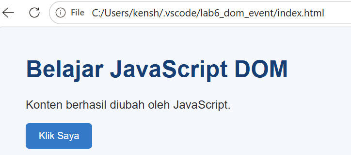

### Latihan 2 — Event Klik Tombol
Menampilkan informasi waktu ketika tombol diklik sebagai penerapan event JavaScript.

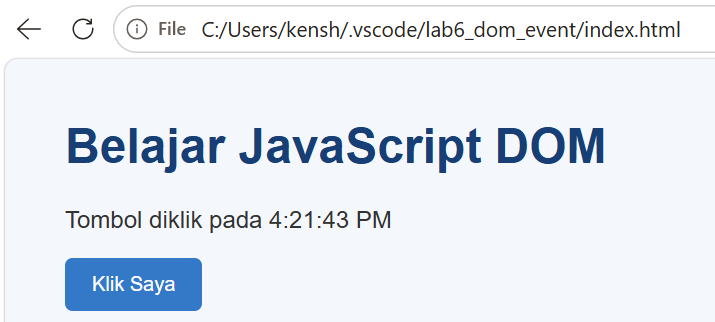

### Latihan 3 — Mengubah Gaya CSS
Mengubah tampilan paragraf menggunakan JavaScript dan CSS melalui tombol.

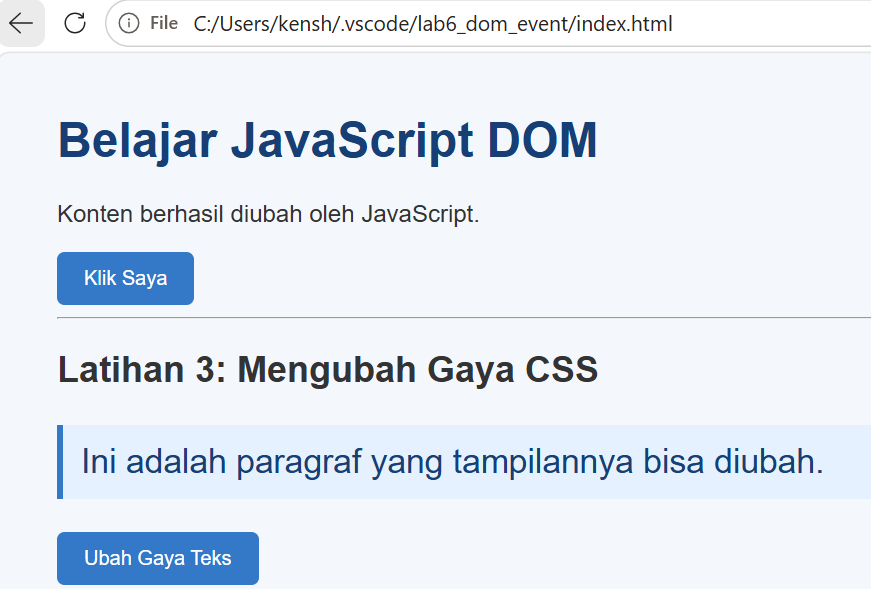

### Latihan 4 — Penghitung Karakter
Menghitung jumlah karakter nama secara otomatis ketika pengguna mengetik pada kolom input.

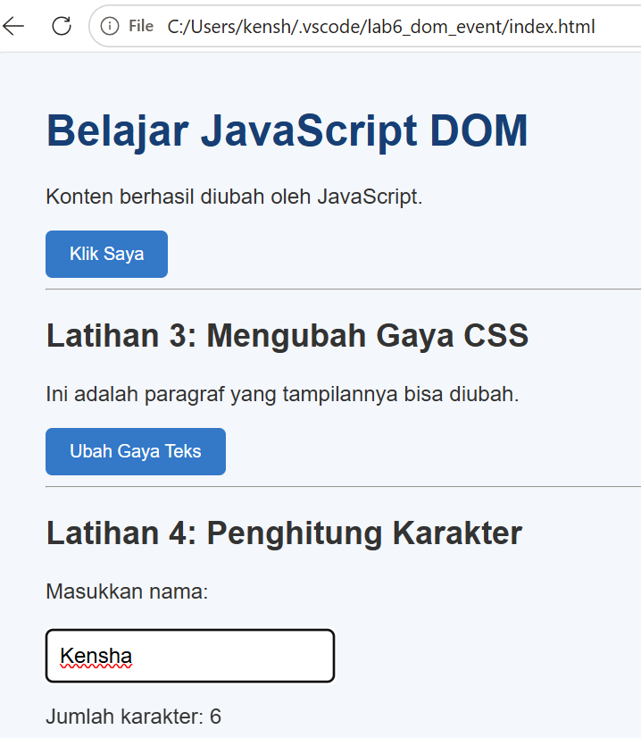

### Latihan 5 — Form Pendaftaran
Membuat form pendaftaran yang berisi nama lengkap, email, dan usia serta melakukan validasi input.

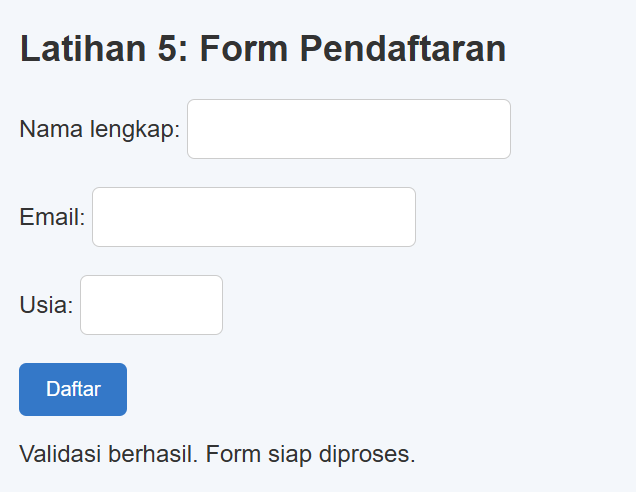

### Latihan 6 — Daftar Tugas
Membuat daftar tugas dengan fitur menambahkan tugas dan menandai tugas yang sudah selesai.

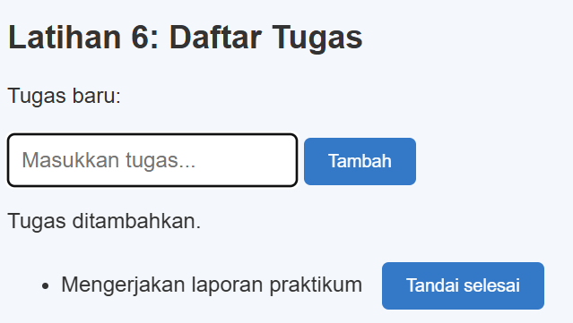

## D. Mini Project — Pendaftaran Workshop
Membuat formulir pendaftaran workshop dengan fitur penghitung karakter nama, validasi nama dan email, pilihan sesi workshop, serta tombol daftar dan reset.

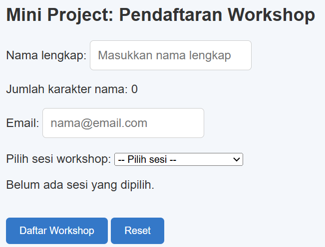

## E. Eksperimen Mandiri

### Eksperimen 1 — Menghapus Item dari Daftar Tugas
Menambahkan tombol untuk menghapus tugas tertentu dari daftar.

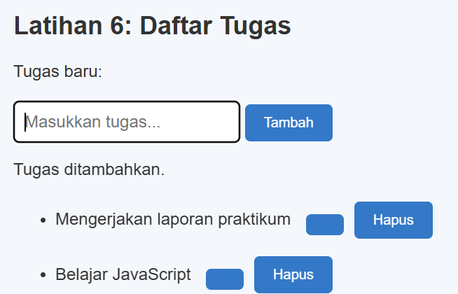
### Eksperimen 2 — Validasi Nama Minimal 3 Karakter
Mengubah validasi agar nama yang dimasukkan harus memiliki minimal tiga karakter.

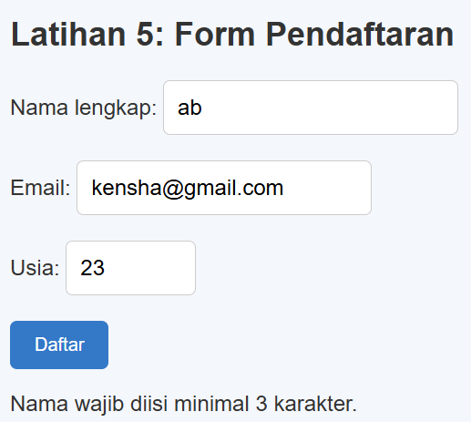

### Eksperimen 3 — Event Change pada Dropdown Workshop
Menampilkan sesi workshop yang dipilih pengguna melalui event `change`.

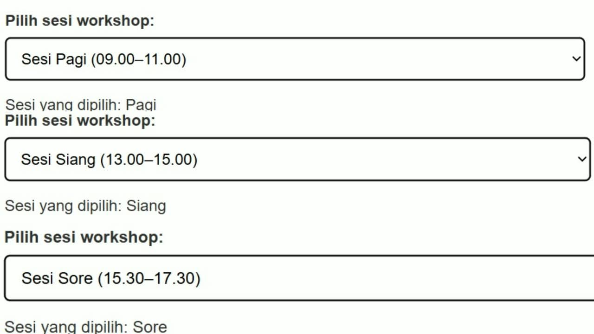

### Eksperimen 4 — Menyembunyikan dan Menampilkan Paragraf
Membuat tombol untuk menyembunyikan dan menampilkan paragraf menggunakan JavaScript dan CSS.

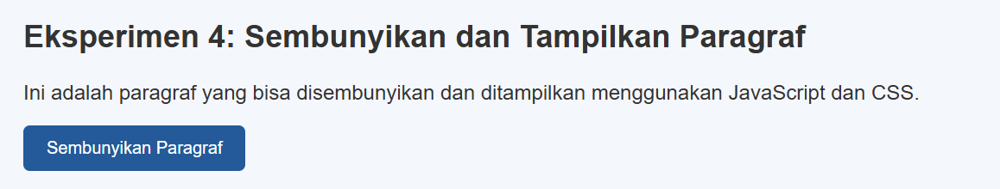

### Eksperimen 5 — Script Tanpa Defer
Memindahkan script ke bagian `<head>` tanpa atribut `defer` untuk mengamati error yang terjadi ketika elemen HTML belum tersedia saat JavaScript dijalankan.

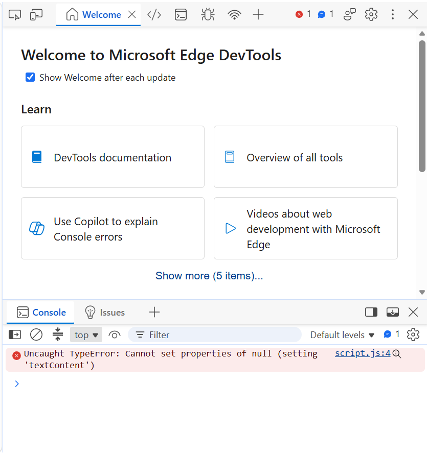

### Pengujian Validasi Nama

Screenshot berikut menunjukkan hasil pengujian validasi nama pada formulir pendaftaran workshop.

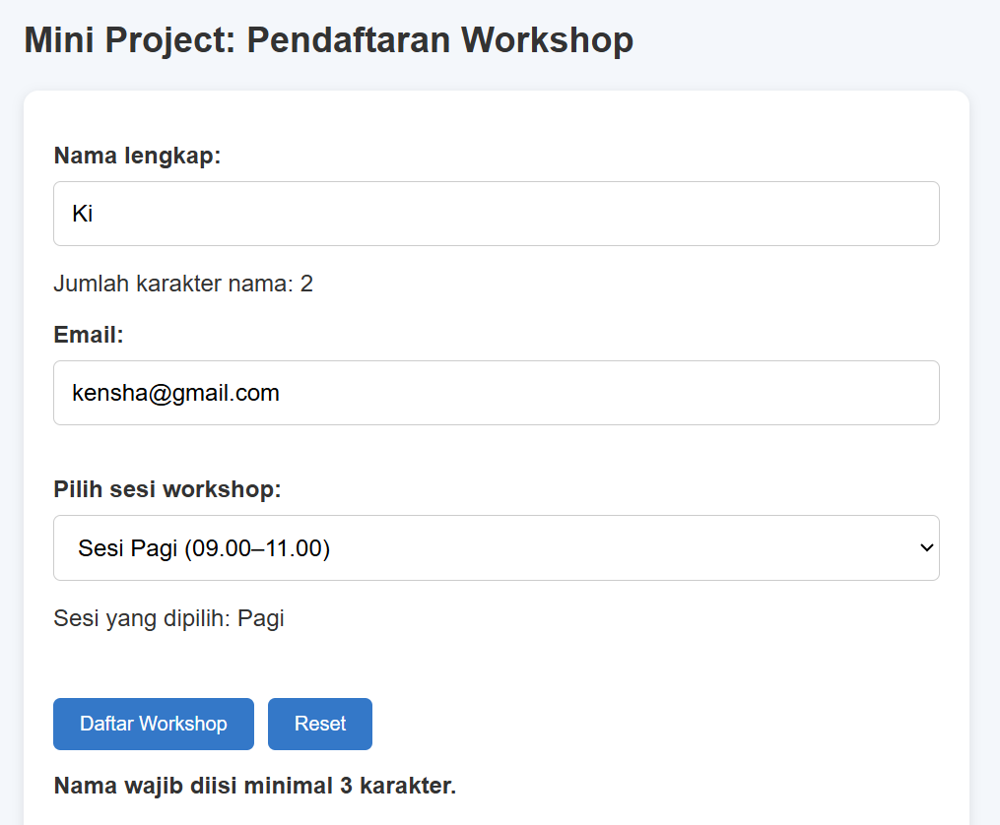

### Pengujian Validasi Email

Screenshot berikut menunjukkan hasil pengujian ketika alamat email yang dimasukkan tidak valid.

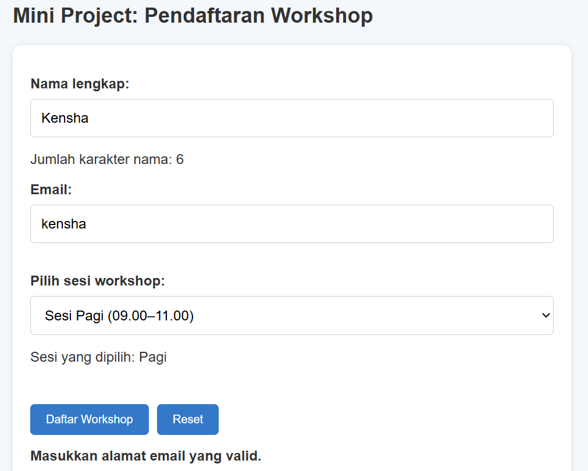

### Hasil Pendaftaran Berhasil

Screenshot berikut menunjukkan pesan konfirmasi setelah formulir pendaftaran workshop berhasil dikirim.

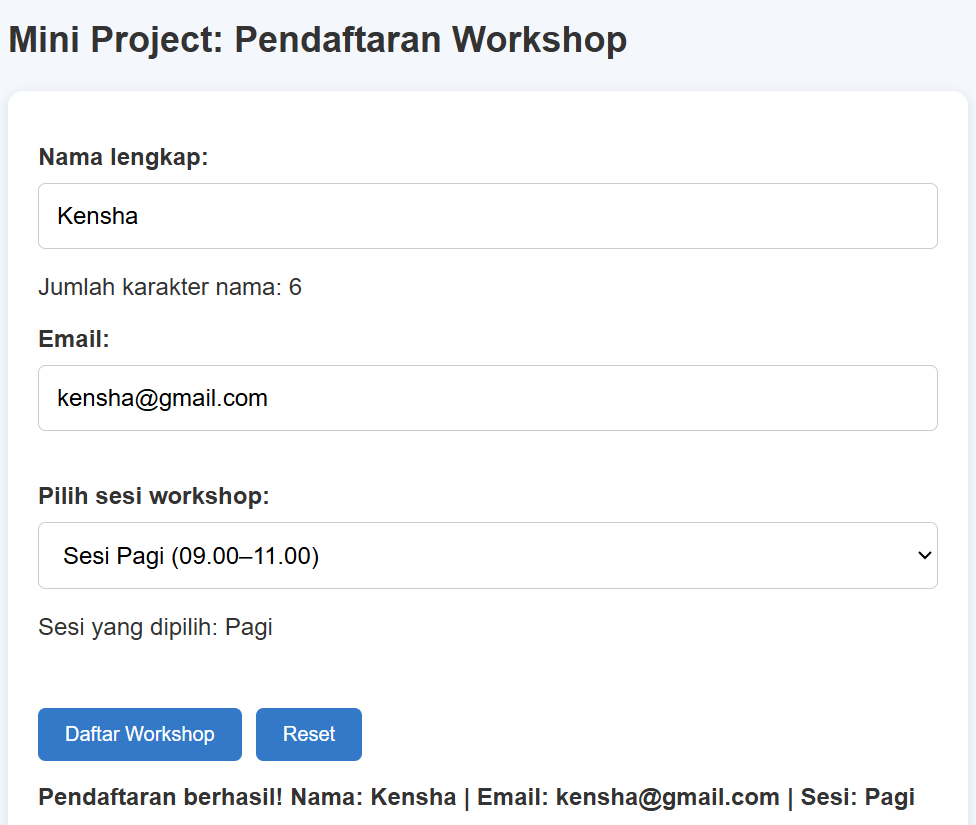

## F. Cara Menjalankan Program
1. Buka folder proyek di Visual Studio Code.
2. Buka file `index.html` menggunakan browser.
3. Klik tombol dan isi formulir untuk mencoba setiap fitur.
4. Amati perubahan tampilan dan pesan yang muncul pada halaman web.
5. Untuk memeriksa error JavaScript, buka Developer Tools pada browser dan pilih tab Console.

## G. Kesimpulan
Praktikum ini membantu memahami penggunaan DOM dan event pada JavaScript untuk membuat halaman web lebih interaktif. Melalui latihan dan eksperimen, JavaScript dapat digunakan untuk mengubah konten, mengatur tampilan CSS, menghitung karakter, memvalidasi formulir, mengelola daftar tugas, serta menampilkan dan menyembunyikan elemen HTML.

## H. Pertanyaan Evaluasi

### 1. Apa yang dimaksud dengan DOM dan apa manfaatnya?

DOM (Document Object Model) adalah representasi dokumen HTML dalam bentuk struktur objek yang dapat diakses oleh JavaScript. DOM bermanfaat untuk mengubah teks, gaya, atribut, dan elemen HTML secara dinamis.

### 2. Apa perbedaan getElementById(), querySelector(), dan querySelectorAll()?

- `getElementById()` digunakan untuk memilih elemen berdasarkan ID.
- `querySelector()` digunakan untuk memilih elemen pertama yang sesuai dengan selector CSS.
- `querySelectorAll()` digunakan untuk memilih semua elemen yang sesuai dengan selector CSS.

### 3. Apa fungsi addEventListener() dan sebutkan tiga contoh event?

`addEventListener()` berfungsi untuk menjalankan kode JavaScript ketika suatu event terjadi pada elemen HTML.

Contoh event:
1. `click` — ketika elemen diklik.
2. `input` — ketika nilai input berubah.
3. `change` — ketika nilai pilihan berubah atau dikonfirmasi.

### 4. Mengapa event.preventDefault() digunakan pada event submit form?

`event.preventDefault()` digunakan untuk mencegah perilaku bawaan form, seperti memuat ulang halaman ketika tombol submit ditekan. Dengan demikian, JavaScript dapat melakukan validasi data terlebih dahulu.

### 5. Apa perbedaan textContent dan innerHTML dari sisi penggunaan dan keamanan?

- `textContent` digunakan untuk membaca atau mengubah teks pada elemen HTML tanpa memprosesnya sebagai kode HTML.
- `innerHTML` digunakan untuk membaca atau mengubah isi HTML suatu elemen.

Dari sisi keamanan, `textContent` lebih aman untuk menampilkan input pengguna karena teks tidak diproses sebagai HTML. Penggunaan `innerHTML` dengan input yang tidak tepercaya dapat menimbulkan risiko serangan XSS.

### 6. Bagaimana classList.toggle() membantu mengubah tampilan elemen?

`classList.toggle()` digunakan untuk menambahkan class CSS jika belum ada atau menghapusnya jika sudah ada. Dengan cara ini, JavaScript dapat mengubah tampilan elemen, misalnya menyembunyikan atau menampilkan paragraf.

### 7. Sebutkan minimal tiga skenario pengujian validasi form.

1. Kolom nama dikosongkan untuk memastikan sistem menampilkan pesan kesalahan.
2. Nama diisi kurang dari tiga karakter untuk memastikan validasi nama berjalan.
3. Email diisi dengan format yang tidak valid untuk memastikan sistem menolak alamat email tersebut.
4. Semua data diisi dengan benar untuk memastikan pendaftaran berhasil.
